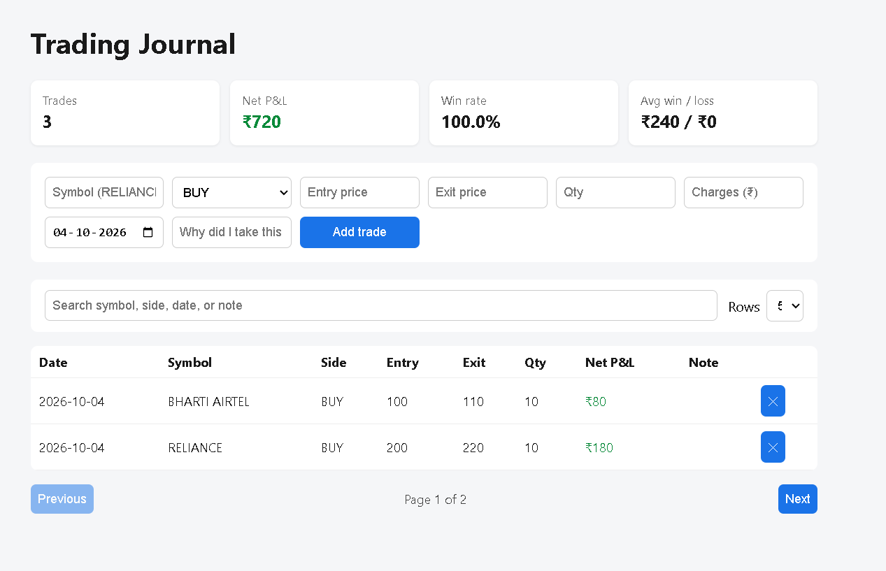

# Trading Journal

Full-stack app to log trades and track net P&L, win rate and average win/loss.

**Stack:** Node.js, Express, React (Vite), REST API, JSON file storage
**Live demo:** <add your Render link here> (demo data only, no auth; free tier may take ~30-60s to wake up)



## Run locally (development)
```bash
# Terminal 1 - API (http://localhost:3001)
cd server && npm install && npm start

# Terminal 2 - Frontend with hot reload (http://localhost:5173)
cd client && npm install && npm run dev
```

## Run as production (single server)
```bash
npm run build   # installs deps, builds React into client/dist
npm start       # Express serves API + built frontend on http://localhost:3001
```

## Deploy on Render (free)
1. Push this repo to GitHub.
2. Render > New > Web Service > connect the repo (it reads `render.yaml`).
3. Build command: `npm run build`, Start command: `npm start`.

Note: free hosts use temporary storage, so demo data resets on restart. Set `DATA_FILE` to a persistent disk path, or move to a database.

## API
| Method | Endpoint | Description |
|---|---|---|
| GET | /api/trades | List trades with net P&L |
| POST | /api/trades | Add a trade (validated) |
| DELETE | /api/trades/:id | Delete a trade |
| GET | /api/stats | Totals, win rate, avg win/loss |

## Known limitations / next steps
- No authentication (add JWT) - anyone with the link can edit demo data
- JSON file storage (replace with MySQL/PostgreSQL)
- Add strategy tags, charts, CSV export, tests
